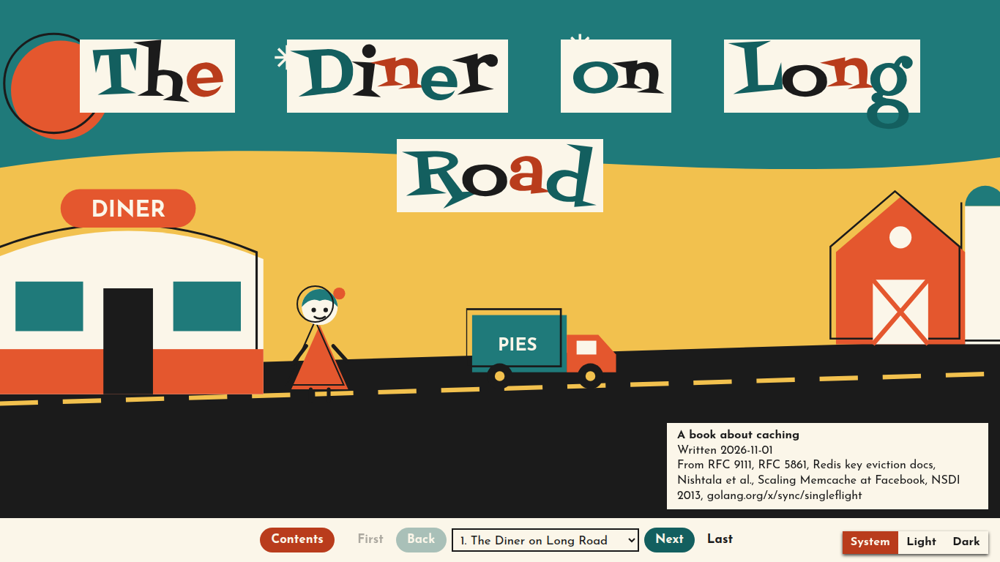
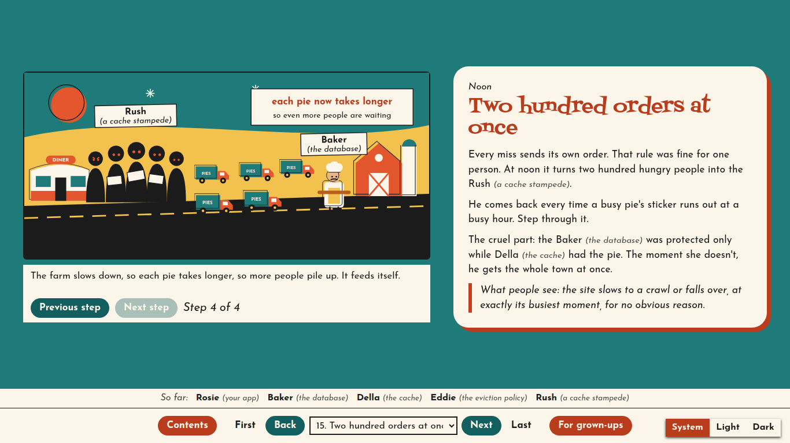
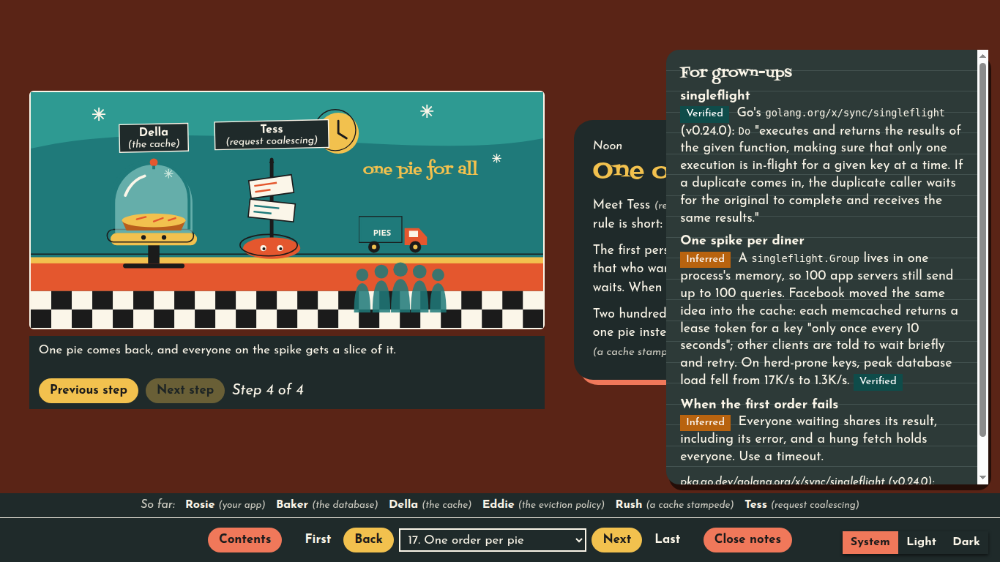

# Once Upon a Stack

**Understand any technical topic properly, as a picture book you keep.**

Ask your coding agent once, and you get an illustrated book about DNS, Kubernetes, React, or your own company's system. It's one HTML file you can open any time, offline, for free, without asking anyone again.



## Why

You've probably been here:

- Someone in a meeting says "it's probably a cache stampede", and you nod.
- You've used Kubernetes for two years, and you still couldn't say why a pod needs a service.
- You asked an AI to explain something last month. It was a great answer. Now it's lost somewhere in your chat history, so you ask again.

Most explanations tell you **what** a thing does. They skip **why it has to exist**, and that's the part that makes it stick.

These books start from the why. Someone wants something simple and tries the obvious way. It breaks, for a real engineering reason. A new character shows up with the fix, and the fix misses something. By the last page you've met every part of the system, and you know what would go wrong without each one.

It's written like a children's book on purpose: a children's book can't assume you already know anything. The engineering underneath stays real, and so do the sources.

## When you'd reach for it

- **You just joined a team.** Point it at the codebase and get the story of how a request really travels through your six services. Read it on your first weekend.
- **Something you use every day is still magic.** "How does React decide what to re-render?" Get an answer that isn't another blog post you half remember.
- **It's 2am and the database is on fire.** Every book ends with a debugging index: find what you're seeing, and it takes you to the page that explains it.
- **You have to explain it to someone else.** Send a new hire or your PM one file. They read the story. The engineers open the notes.
- **You've got an interview coming up.** You'll be able to explain why a cache needs an eviction policy, not just that it has one.

## See one

*The Diner on Long Road* is a 23-page book about caching, made by this skill. **[Read it in your browser](https://andrewlawendy.github.io/once-upon-a-stack/demo/the-diner-on-long-road.html)**

Rosie wants a slice of pie. Every pie is baked at a farm at the far end of a long road, so she has to wait. A pie case on the counter fixes that, until the recipe changes and the case is still selling the old one.

At noon, a popular pie's date sticker runs out, and two hundred people miss at once. That's a real failure with a real name, and it gets a villain. Every character keeps its real job right next to its name, so you never have to remember who's who.



For engineers, every page has a "For grown-ups" drawer with the real terms, config and sources. Each claim is marked Verified, Inferred or Unknown.



## What a book is like

- **Pages, not a long scroll.** Built for a laptop, with light and dark themes and quiet motion.
- **Things you can try.** Step through a journey, or drag a slider to see before and after.
- **Researched, not improvised.** The agent reads the code, specs and papers. What it can't settle goes on a "What we don't know yet" page.
- **Its own look.** Each book picks a style that suits its topic: cut paper, woodcut, mid-century, stained glass, blueprint, vintage poster or pixel art.

## Usage

```
/once-upon-a-stack DNS
/once-upon-a-stack how React decides what to re-render
/once-upon-a-stack rewrite the caching chapter of The Thirteen Roots
```

The first time you run it, the agent asks where to keep your books and suggests `~/once-upon-a-shelf`. Open `index.html` in that folder to see your shelf.

1. The agent maps the topic and shows you a table of contents: the world, the art style, and each chapter's goal, attempts, breaks and new characters. This is the only stop. Nothing is built until you approve it.
2. It researches each journey in parallel, writes and draws the pages, builds the book, and checks every page in a headless browser, in light and dark.
3. It hands you the path to the book and says which parts are weakest.

A big topic can take a while and use a lot of tokens: a 45-page book runs several research agents.

## Requirements

- Claude Code, or another coding agent that supports [Agent Skills](https://agentskills.io)
- Python 3
- Node.js 22 or newer
- Google Chrome, Chromium, Edge or Brave, for the visual check. If it isn't found, set `CHROME_PATH` to the browser's executable.

## Install

In Claude Code (2.1.275 or later):

```
/plugin install once-upon-a-stack --marketplace AndrewLawendy/once-upon-a-stack
```

Or clone the repo and link the skill into your skills folder:

```
git clone https://github.com/AndrewLawendy/once-upon-a-stack.git
ln -s "$PWD/once-upon-a-stack/skills/once-upon-a-stack" ~/.claude/skills/once-upon-a-stack
```

### Other coding agents

Codex, Gemini CLI, GitHub Copilot and Cursor all read skills from `~/.agents/skills`, so one link covers them:

```
git clone https://github.com/AndrewLawendy/once-upon-a-stack.git
mkdir -p ~/.agents/skills
ln -s "$PWD/once-upon-a-stack/skills/once-upon-a-stack" ~/.agents/skills/once-upon-a-stack
```

Then ask for a book in plain words, such as "make a picture book about DNS". These agents are supported by their documentation but not tested yet. Agents that can't start subagents or view images still work, with a few extra steps the skill explains.

## Status

Work in progress. The visual check is tested on Linux; the macOS and Windows browser paths are written but not yet tested on those systems.

## License

MIT. The bundled fonts keep their own licenses: see [`font-licenses`](skills/once-upon-a-stack/assets/font-licenses).
